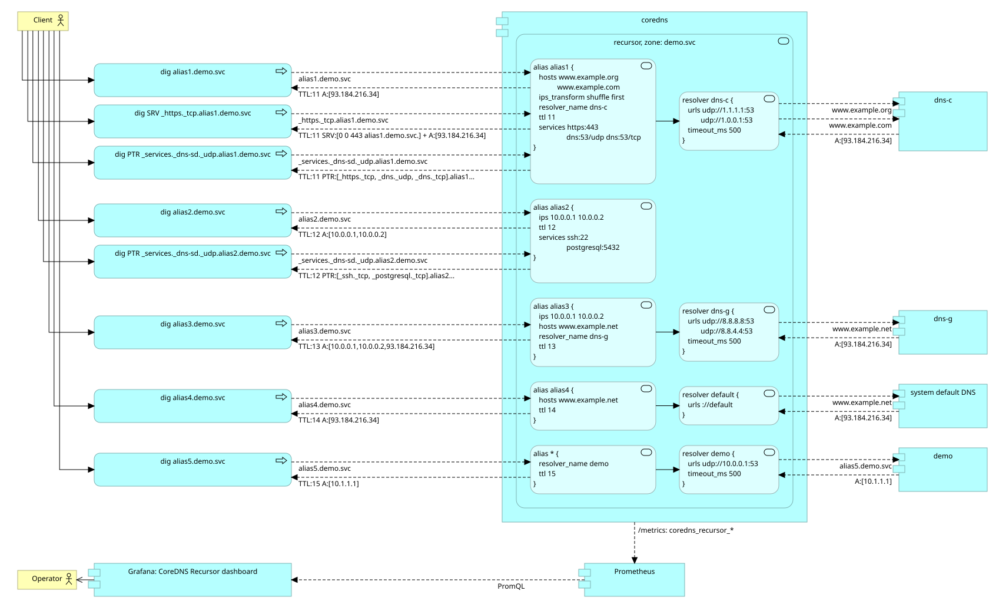
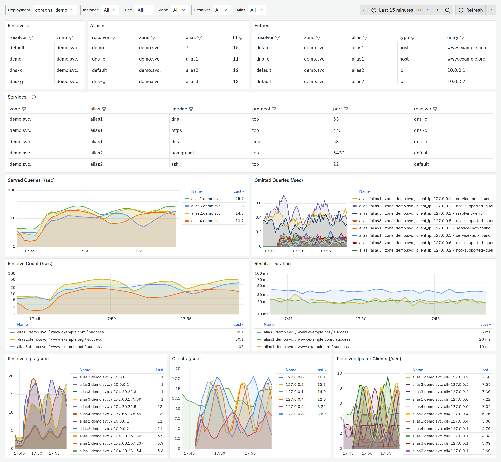

# `recursor` - CoreDNS Plugin

The `recursor` answers queries for aliases in a zone with IP addresses: static ones, addresses of other domains
resolved with selected DNS servers, or both. It can also publish the services available at an alias
(name, port, protocol) as a [service catalog](#service-catalog), in DNS and in Prometheus metrics.

## Compatibility

| Plugin            | CoreDNS | Go     |
|-------------------|---------|--------|
| `1.6.0`           | 1.15.0  | ≥ 1.26 |
| `1.5.0`           | 1.15.0  | ≥ 1.26 |
| `1.4.0`           | 1.12.3  | ≥ 1.24 |
| `1.3.1`           | 1.12.2  | ≥ 1.23 |
| `1.3.0`           | 1.12.0  | ≥ 1.22 |
| `1.2.1`           | 1.11.3  | ≥ 1.21 |
| `1.0.0` – `1.1.3` | 1.10.0  | ≥ 1.19 |

> **Upgrading to 1.6.0:** 1.6.0 adds [alias patterns](#alias-patterns), e.g. `*-x`. An alias name with `*` other than
> `*` itself is now a pattern: before, `*-x` matched only the literal name `*-x`. Two `*` in one name and patterns with
> `services` are configuration errors.

> **Upgrading to 1.5.0:** review your configuration first, CoreDNS won't start with some configs that worked before.
>
> - `timeout_ms` now limits the whole lookup (including retries) against a resolver URL. Before, it applied only to
>   opening the connection, which has no effect for UDP, so it was effectively ignored. Very small values (e.g. `10`)
>   now cause timeouts with remote upstreams. Without `timeout_ms`, lookups are limited to 2 s (were unlimited).
> - The configuration is validated strictly. These were silently ignored and are now errors:
>   - unknown `ips_transform` functions (e.g. `shufle`),
>   - unknown keys in YAML/JSON files (e.g. `timeout` instead of `timeout_ms`),
>   - `shuffle_ips` values other than `true`/`false`,
>   - resolver URLs without the `udp://` or `tcp://` scheme or without a port,
>   - `ttl` outside 0–2147483647,
>   - alias names that differ only in case (alias names are now case-insensitive, as queries).
> - Metric labels no longer contain query names: unknown names are counted with `alias=""`, names answered by the
>   `*` alias with `alias="*"` and `host="*"`. See [Metrics](#metrics).
>
> 1.5.0 also adds the [service catalog](#service-catalog) (`services`). It is opt-in: configurations without
> `services` answer exactly as before.

## Use Case

The [example configuration](#example) with the queries it answers, and the service catalog in Prometheus and Grafana:



Source: [docs/flow.archimate](docs/flow.archimate) ([Archi](https://www.archimatetool.com/) model),
also as [PNG](docs/flow.png).

## How It Works

- The plugin answers `A`, `AAAA` and `ANY` queries (`ANY` returns both families) for names in the server block's zone.
  The alias is the part of the query name before the zone, matched case-insensitively
  (e.g. `api.v1.demo.svc.` in zone `demo.svc` → alias `api.v1`).
- The answer contains the alias' static `ips` plus the addresses resolved for its `hosts`, deduplicated and filtered
  to the family asked for, then passed through `ips_transform`. If nothing matches the family, the answer is
  empty (`NOERROR`/NODATA).
- An explicit alias wins over [alias patterns](#alias-patterns) (e.g. `*-x`), and patterns win over `*`. The `*` alias
  and patterns resolve the original query name with their resolver, unless they define their own `hosts`/`ips`
  (use `hosts *` to include the original name alongside them).
- The upstreams are asked only for the address family the client asked for (`A` → `A`, `AAAA` → `AAAA`).
  All hosts of an alias are resolved in parallel.
- All URLs of a resolver are queried in parallel. The first successful answer is used and the lookups still running
  are cancelled. Truncated UDP answers are retried over TCP.
- Answers are authoritative. Empty answers carry a synthesized `SOA` record of the zone, so downstream resolvers can
  cache them for the alias' `ttl`.
- The query is passed to the next plugin in the chain when:
  - the query type is not supported,
  - no alias matches,
  - or any of the alias' `hosts` cannot be resolved.

  If there is no next plugin, the response is `SERVFAIL`.
- Aliases with `services` also answer the service names described in [Service Catalog](#service-catalog).

## Configuration

### Corefile Directives

```txt
recursor {
    external-yaml <file>
    external-json <file>
    verbose 0..2
    client_ip_metrics true|false
    resolver <name> {
        urls <url>...
        timeout_ms <ms>
    }
    alias <name> {
        ips <ip>...
        hosts <domain>...
        ips_transform <function>...
        shuffle_ips true|false
        resolver_name <resolver>
        ttl <seconds>
        services <name:port[/protocol]>...
    }
}
```

All directives are optional and `resolver`/`alias` can be repeated.

`external-yaml` and `external-json` load the whole configuration from a file, with the same options as below
(`resolvers` and `aliases` are maps keyed by name). The file replaces what is defined before it in the block, so put it
first. A relative path is resolved against the Corefile's directory, like CoreDNS `import`; if the file isn't there,
against the CoreDNS working directory (as before 1.5.0). Unknown keys in the file are an error.

### Options

- `verbose`: The logging level for stdout:
    - `0`: minimal logging
    - `1`: moderate logging
    - `2`: detailed logging

  Events of single queries (unknown alias, unsupported type, failed lookup of one URL) are logged at debug level,
  shown with the CoreDNS [`debug`](https://coredns.io/plugins/debug/) plugin. Failed resolving of an alias is a warning.
- `client_ip_metrics`: Default is `true`. Adds the client's IP to the `client_ip` label of the query metrics,
  one series per client. Set to `false` when the server has many clients (the label is then empty).
- `resolvers` (Corefile: `resolver <name>`): Other DNS servers to use:
    - *name*: The name of the resolver. The name `default` overrides the system's default resolver.
    - `urls`: A list of URLs `udp://<host>:<port>` or `tcp://<host>:<port>`, e.g. `udp://127.0.0.1:53`
      (the system default is represented by `://default`). With `udp://`, truncated answers are retried over TCP;
      `tcp://` always uses TCP.
    - `timeout_ms`: Maximum time, in milliseconds, for a single lookup (including retries) against each of the
      resolver URLs. Default: `2000` (also for the `default` resolver). URLs are queried in parallel and the first
      successful answer is used.
- `aliases` (Corefile: `alias <name>`): Domain aliases:
    - *name*: The alias name, a subdomain, a [pattern](#alias-patterns) with one `*` (e.g. `*-x`), or `*` if you want
      the recursor to act as a DNS repeater. Case-insensitive.
    - `ips`: A list of IP addresses to be returned as part of the response.
    - `hosts`: Domains that will be resolved, with the resulting IP addresses returned in the response.
    - `shuffle_ips`: `true` or `false` (default). If `true`, IP addresses will be returned in random order. Deprecated,
      use `ips_transform` instead.
    - `ips_transform`: A list of transformations applied sequentially to the list of IP addresses before returning them.
      Default: empty (no transformation). An unknown function is a configuration error. Supported functions
      (applied in order):
        - `shuffle`: randomizes the order of addresses
        - `sort_asc`: sorts addresses in ascending binary order
        - `sort_desc`: sorts addresses in descending binary order
        - `first`: keeps only the first address (if any)
        - `last`: keeps only the last address (if any)
        - `random_one`: keeps exactly one random address (if any)
        - `prefer_ipv4`: stable-partitions list to place IPv4 first
        - `prefer_ipv6`: stable-partitions list to place IPv6 first
        - `limit_n`: keeps only the first `n` addresses (e.g., limit_2). n≥0, n=0 yields an empty list.
    - `resolver_name`: The name of the resolver to use. The default is... well, `default`, of course :)
    - `ttl`: Time To Live for the DNS record, in seconds, 0–2147483647. Default: `0`.
    - `services`: Services available at the alias, published as SRV records for the
      [service catalog](#service-catalog). Each entry is `name:port[/protocol]`, e.g. `https:443`, `dns:53/udp`:
        - `name`: 1–15 characters, letters, digits and inner hyphens, at least one letter (RFC 6335).
          Case-insensitive. Use names from the
          [IANA registry](https://www.iana.org/assignments/service-names-port-numbers)
          (`https`, `ldap`, `kerberos`, ...) when standard clients should discover the service.
        - `port`: 1–65535.
        - `protocol`: `tcp` (default), `udp` or `sctp`.

      The same name may be used with different protocols (`dns:53/udp` and `dns:53/tcp`). The same name and protocol
      twice is an error. Not allowed for the `*` alias and alias patterns. In a Corefile, the `services` directive may be repeated to
      split long lists.

### Alias Patterns

An alias name with one `*` inside, e.g. `*-x`, `web-*` or `api-*.eu`, answers every name it matches. The `*` matches
one or more characters within a single label (no dots), like a TLS certificate wildcard: `*-x` matches `foo-x`,
but not `-x` or `a.foo-x`.

When several aliases match a name, the most specific one wins, regardless of the order in the configuration
(like `server_name` in nginx or certificate selection by SNI in HAProxy):

1. the explicit alias (`api-x`),
2. the pattern with the most characters other than `*` (`web-*` before `*-x` for `web-x`),
3. with the same count, the pattern with the longer part after `*` (`*b-x` before `abc*`),
4. the `*` alias.

Two different patterns equal on both counts can't match the same name, so the choice is always unambiguous.

```txt
recursor {
    alias api-x {
        ips 10.0.0.1             # api-x
    }
    alias *-x {
        ips 10.0.0.50            # foo-x, bar-x, ... → HAProxy
        ttl 30
    }
    alias * {
        resolver_name upstream   # everything else
    }
}
```

A pattern without `ips` and `hosts` resolves the original query name, like `*`, e.g. to send a group of names to
another resolver. Metrics use the pattern as the `alias` label. Patterns can't define `services`.

### Example

The configuration shown in the [diagram](#use-case) ([examples/demo.caddy](examples/demo.caddy)):

```txt
recursor {
    verbose 0

    resolver dns-c {
        urls udp://1.1.1.1:53 udp://1.0.0.1:53
        timeout_ms 500
    }
    resolver dns-g {
        urls udp://8.8.8.8:53 udp://8.8.4.4:53
        timeout_ms 500
    }
    resolver demo {
        urls udp://10.0.0.1:53
        timeout_ms 500
    }

    alias alias1 {
        hosts www.example.org www.example.com
        ips_transform shuffle first
        resolver_name dns-c
        ttl 11
        services https:443 dns:53/udp dns:53/tcp
    }
    alias alias2 {
        ips 10.0.0.1 10.0.0.2
        ttl 12
        services ssh:22 postgresql:5432
    }
    alias alias3 {
        ips 10.0.0.1 10.0.0.2
        hosts www.example.net
        resolver_name dns-g
        ttl 13
    }
    alias alias4 {
        hosts www.example.net
        ttl 14
    }
    alias * {
        resolver_name demo
        ttl 15
    }
}
```

The same configuration in other formats (the tests check that all of them are equivalent):

| Format | File | Loaded with |
|---|---|---|
| YAML | [examples/demo.yaml](examples/demo.yaml) | [examples/demo-yaml.caddy](examples/demo-yaml.caddy): `external-yaml examples/demo.yaml` |
| JSON | [examples/demo.json](examples/demo.json) | [examples/demo-json.caddy](examples/demo-json.caddy): `external-json examples/demo.json` |

A complete, runnable server block is in [examples/Corefile](examples/Corefile) (see [Try It](#try-it)).
[More examples](examples).

## Service Catalog

Services defined with `services` are available in two ways: in DNS, for scripts and clients, and as a Prometheus
metric, for Grafana and scripts with access to Prometheus.

### DNS

For an alias with services, e.g. `alias1` in the zone `demo.svc`:

| Query | Answer |
|---|---|
| `PTR _services._dns-sd._udp.alias1.demo.svc` | The list of the alias' services, one `PTR` per service (DNS-SD service type enumeration, RFC 6763 §9). |
| `SRV _https._tcp.alias1.demo.svc` | `0 0 443 alias1.demo.svc.` (priority, weight, port, target), with the target's `A`/`AAAA` records in the additional section. |
| Other types for these names | Empty `NOERROR` answer (NODATA). |
| An undefined service, e.g. `_ldap._tcp.alias1.demo.svc` | Passed to the next plugin, like an unknown alias. |

Notes:

- **TTL:** the alias' `ttl`.
- **Target addresses:** the additional section uses the same addresses an `A`/`AAAA` query for the alias returns,
  including `ips_transform`. If the alias' `hosts` can't be resolved, the `SRV` record is still returned, without them.
- **Name conflicts:** a name explicitly configured as an alias (e.g. `alias _x._tcp.alias1`) takes precedence over
  a service name.
- **Compatibility:** service names are only answered for aliases that define `services`. Existing configurations
  behave exactly as before.

With the [example](#example) running ([Try It](#try-it)):

```bash
# List the services of an alias
$ dig +short PTR _services._dns-sd._udp.alias1.demo.svc @127.0.0.1 -p 1053
_https._tcp.alias1.demo.svc.
_dns._udp.alias1.demo.svc.
_dns._tcp.alias1.demo.svc.

# Port and target of one service
$ dig +short SRV _https._tcp.alias1.demo.svc @127.0.0.1 -p 1053
0 0 443 alias1.demo.svc.

# The target's addresses come in the additional section
$ dig SRV _ssh._tcp.alias2.demo.svc @127.0.0.1 -p 1053
;; ANSWER SECTION:
_ssh._tcp.alias2.demo.svc. 12   IN      SRV     0 0 22 alias2.demo.svc.

;; ADDITIONAL SECTION:
alias2.demo.svc.        12      IN      A       10.0.0.1
alias2.demo.svc.        12      IN      A       10.0.0.2
```

A script collecting the catalog of the given aliases:

```bash
#!/usr/bin/env bash
# usage: ./catalog.sh demo.svc alias1 alias2 ...   → CSV: alias,service,protocol,port,target
set -euo pipefail
DNS=(@127.0.0.1 -p 1053)
zone=$1; shift
echo "alias,service,protocol,port,target"
for alias in "$@"; do
  for srv in $(dig +short PTR "_services._dns-sd._udp.${alias}.${zone}" "${DNS[@]}"); do
    IFS=. read -r svc proto _ <<<"$srv"
    read -r _prio _weight port target < <(dig +short SRV "$srv" "${DNS[@]}")
    echo "${alias},${svc#_},${proto#_},${port},${target}"
  done
done
```

```bash
$ ./catalog.sh demo.svc alias1 alias2 alias3
alias,service,protocol,port,target
alias1,https,tcp,443,alias1.demo.svc.
alias1,dns,udp,53,alias1.demo.svc.
alias1,dns,tcp,53,alias1.demo.svc.
alias2,ssh,tcp,22,alias2.demo.svc.
alias2,postgresql,tcp,5432,alias2.demo.svc.
```

### Prometheus / Grafana

Each service is a series of `coredns_recursor_aliases_services_info`:

```
coredns_recursor_aliases_services_info{port="1053", zone="demo.svc.", alias="alias1", resolver="dns-c",
                                       service="https", protocol="tcp", service_port="443"} 1
```

- `port` is the CoreDNS listening port, the same label as in the other metrics. The service's port is `service_port`.
- The [Grafana dashboard](docs/dashboard.json) shows the catalog in the **Services** table.
- Scripts can read the whole catalog from the Prometheus HTTP API:

```bash
curl -s 'http://prometheus:9090/api/v1/query' \
  --data-urlencode 'query=coredns_recursor_aliases_services_info' \
  | jq -r '.data.result[].metric | [.zone, .alias, .service, .protocol, .service_port] | @csv'
```

## Metrics

All metrics are prefixed with `coredns_recursor_` and have the labels `port` (CoreDNS listening port) and `zone`,
except `build_info`. Definitions: [metrics.go](metrics.go).

| Metric | Type | Other labels | Description |
|---|---|---|---|
| `build_info` | gauge | `version` | Plugin version. |
| `resolvers_info` | gauge | `resolver`, `urls` | Configured resolvers. |
| `aliases_info` | gauge | `alias`, `resolver`, `ttl` | Configured aliases. |
| `aliases_entries_info` | gauge | `alias`, `resolver`, `type` (`host`/`ip`), `entry` | Hosts and IPs of the aliases. |
| `aliases_services_info` | gauge | `alias`, `resolver`, `service`, `protocol`, `service_port` | Services of the aliases ([service catalog](#service-catalog)). |
| `query_served_count_total` | counter | `alias`, `resolver`, `client_ip` | Answered queries. |
| `query_omitted_count_total` | counter | `alias`, `reason`, `client_ip` | Queries passed to the next plugin. `reason`: `not-supported-query-code`, `alias-not-found`, `alias-empty-def`, `resolving-error`, `service-not-found`. |
| `resolve_count_total` | counter | `alias`, `resolver`, `host`, `result` (`success`/`error`) | Lookups of `hosts` per resolver URL. Lookups cancelled because another URL answered first are not counted. |
| `resolve_duration_ms` | gauge | as above | Duration of the last lookup. |
| `resolve_duration_ms_total` | counter | as above | Total duration of lookups. |
| `resolve_ip_count_total` | counter | `alias`, `resolver`, `ip` | Addresses returned in answers. |

- The `*_info` metrics describe the configuration. When the configuration is reloaded (`reload` plugin), the series of
  the reloaded server block are replaced, so removed items disappear.
- Label values come from the configuration, never from query names, so queries for random names don't create new
  series: `alias` is the configured alias, `*` for names answered by the `*` alias, or empty when no alias matches;
  `host` is `*` for lookups of the original name by the `*` alias.
- `client_ip` makes one series per client. With many clients, set `client_ip_metrics false` (the label is then empty).

The [Grafana dashboard](docs/dashboard.json) filters by deployment, instance, port, zone, resolver and alias.
The deployment is the `bosh_deployment` label, set by the [BOSH release](https://github.com/kinjelom/coredns-boshrelease).
Elsewhere, add it in the Prometheus scrape config, otherwise the dashboard stays empty:

```yaml
scrape_configs:
  - job_name: coredns
    static_configs:
      - targets: [ "coredns:9153" ]
        labels:
          bosh_deployment: coredns-demo
```

The dashboard with the [example](#example) under demo traffic:



## Caching

The plugin asks the upstreams on every query. To cache its answers, add the CoreDNS
[`cache`](https://coredns.io/plugins/cache/) plugin to the same server block; it runs before `recursor` in the chain:

```txt
demo.svc:1053 {
    cache 10
    recursor { ... }
}
```

Answers are cached for the alias' `ttl` (at most the `cache` maximum), so aliases with the default `ttl 0` are not
cached. The cache returns the same answer until it expires, so `shuffle`, `random_one` and `shuffle_ips` change the
order or choice of addresses only once per cache period.

## Build It

Requires Go 1.26 or newer (see [Compatibility](#compatibility)). External plugins are compiled into CoreDNS:

```bash
#!/usr/bin/env bash
set -eu
git clone --depth 1 --branch v1.15.0 https://github.com/coredns/coredns.git
cd coredns
# Add the plugin
go get github.com/kinjelom/coredns-recursor@latest
grep -q '^recursor:' plugin.cfg || echo "recursor:github.com/kinjelom/coredns-recursor" >> plugin.cfg
# Build
go generate
go build
./coredns -plugins | grep recursor
```

The position in `plugin.cfg` sets the plugin's order in the chain. Appended at the end, `recursor` runs after the
other plugins of the same server block.

### Deployments Ready to Use

- [BOSH Release](https://github.com/kinjelom/coredns-boshrelease)

## Try It

Run the [example](#example) on port `1053`, with metrics on `:9153`:

```bash
./coredns -conf examples/Corefile
```

```bash
# sudo apt-get install dnsutils
$ dig +short alias2.demo.svc @127.0.0.1 -p 1053
10.0.0.1
10.0.0.2
$ nslookup -port=1053 -type=A alias3.demo.svc 127.0.0.1
$ dig PTR _services._dns-sd._udp.alias1.demo.svc @127.0.0.1 -p 1053
$ dig SRV _https._tcp.alias1.demo.svc @127.0.0.1 -p 1053
$ curl -s localhost:9153/metrics | grep '^coredns_recursor_'
```

`alias5.demo.svc` (the `*` alias) is forwarded to `10.0.0.1:53`, which in most networks does not answer: the query
times out after `timeout_ms` and is counted in `query_omitted_count_total` with `reason="resolving-error"`.

## Development

```bash
go test -race ./...
```

- Most tests use an in-process fake DNS server and need no network. The tests in `recursor_test.go` query public
  resolvers (`8.8.8.8`, `one.one.one.one`), so they need Internet access.
- The tests check that [examples/demo.caddy](examples/demo.caddy) appears verbatim in this README and that its
  YAML/JSON versions are equivalent. Change them together.
- The diagram is edited in [Archi](https://www.archimatetool.com/) ([docs/flow.archimate](docs/flow.archimate)) and
  exported to `docs/flow.svg` and `docs/flow.png`.
